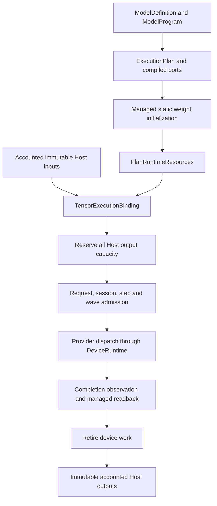

# Managed tensor execution

Ferrum's tensor execution path shares the model compiler, operation contracts,
device runtime and resource ledger with text inference. It has its own work
domain. A diffusion timestep is not an autoregressive token step.

The current implementation executes an exact-shape component synchronously on
the Reference backend. This is a foundation for image pipelines; it does not
yet provide a complete image model, an image CLI command or an HTTP image API.

## Compilation and dispatch

`ModelSemanticMetadata::TensorComponent` describes a component without invented
vocabulary, context-window or KV-head metadata. `RuntimeWorkLimits::FixedTensor`
requires fixed tensor shapes, one active participant and providers that explicitly
support tensor work. Compiled ports come from the actual program value and
physical storage bindings; equal element counts do not make different shapes,
types or layouts interchangeable.



`PreparedTensorExecutor` consumes the executable plan, bound providers, live
resource root and a shared `HostMemoryAccount`. Each call binds actual input
owners to that root. Work evidence cannot be moved between distinct roots, even
when their compiled plan hashes match. A binding nonce avoids hashing the input
payload on every submission; port, shape and ownership checks still run.

Logical capacity deferrals return to the caller. The typed executor configuration
bounds physical backing maintenance; it does not authorize a busy wait for
logical capacity. A future diffusion scheduler must decide when a deferred job
can run and how compatible resolution/step/task groups are batched.

## Memory ownership

The Host parent account is injected by product composition and cloned across
cooperating engines. Its total and class limits cover backing bytes and outstanding
reservations. Creating separate parents with the same numeric limits does not
create shared authority.

- Input tensors retain their immutable backing owner and its full charge,
  including when the tensor uses only a slice of a larger allocation.
- All output buffers are reserved atomically before device admission. An output
  capacity failure therefore cannot leave a submitted job waiting for Host quota.
- Managed upload commands retain the actual input owner through completion.
- Managed readback writes directly into pre-admitted output buffers. The current
  backend interface is synchronous: no backend access to borrowed destination
  memory may survive a return, error or unwind.
- Returned output clones and slices retain their charge until the last owner
  drops. Closing the device plan does not revoke a caller's Host output.

These limits do not account for every allocation in the process. Provider
scratch, static weight loading, allocator metadata, page cache and future codec
or HTTP buffers require their own integration. The current Host allocation is
pageable; a transfer class is not evidence of page locking or async DMA safety.

## Completion and recovery

Only a successful terminal compute receipt followed by successful readback can
produce outputs. Any failed readback discards the whole private output set,
including buffers partially written by the backend. Backend errors and panics
fail-close the lane; ordinary validation failures do not imply an in-flight
device operation.

`TensorExecutionError::Readback` keeps the compute receipt and cleanup owner
separate from the output failure. A successful compute receipt is not rewritten
as a compute failure when a later Host readback fails.

`FailedButQuiescent` proves that device work has stopped and can be retired.
An indeterminate observation does not prove quiescence. The error retains the
existing completion/reaper authority and a `TensorExecutionRetirement` owner;
the caller must use the runtime recovery protocol before retirement can succeed.
Dropping an error does not authorize reuse of unproven device memory.

`TensorExecutionRetirement::try_abort` releases its session and input evidence
when cleanup succeeds, even if the caller keeps the diagnostic object. Other
live owners can still retain their own claims. A failed cleanup retains the
exact step/session so it can be retried.

Nonterminal managed readback consumes the supplied output destinations. Recovery
supports safe cleanup, not resuming output production for that failed call.
An asynchronous executor will need an explicit owned output/completion contract.

## Image pipeline boundary

The image-domain layer belongs in `ferrum-diffusion`: conditioning, denoising
schedules, latent layouts and VAE orchestration. `FlowMatchEuler` and the spatial
latent/normalization routines currently provide checked CPU reference mathematics
over caller-owned slices. They are neither device allocation authorities nor
evidence of BF16/CUDA numerical parity.

Future component handoffs must retain both participating resource roots until
the transfer completes and account for the real overlap. Component offloading
must use explicit residency management; `PlanRuntimeResources::close` is a
terminal lifecycle operation, not an offload toggle.

Model-specific attention semantics belong in declared component/operator
contracts. For example, Qwen-Image 2.1 has a block-causal conditioning prefix and
a bidirectional target region. Neither a generic full-attention assumption nor
the text Paged KV path expresses that contract.

The shared tensor/ownership layer can support future audio or video components.
Their request types, temporal layouts and scheduling policies should be added
in their respective domain layers rather than extending a token request with
unrelated media fields.

## Validation

Hardware-independent tests exercise real Reference F16 weights, compilation,
managed execution, independent numerical expectations and Host capacity limits:

```text
cargo test -p ferrum-models --test vnext_tensor_reference_runtime
cargo test -p ferrum-runtime --lib
cargo test -p ferrum-kernels --lib backend::reference
cargo test -p ferrum-diffusion
```

These tests do not establish complete image-model correctness or GPU performance.
Those require pinned model/operator versions, intermediate numerical oracles,
valid generated images and same-hardware serving measurements under declared
latency and quality constraints.
